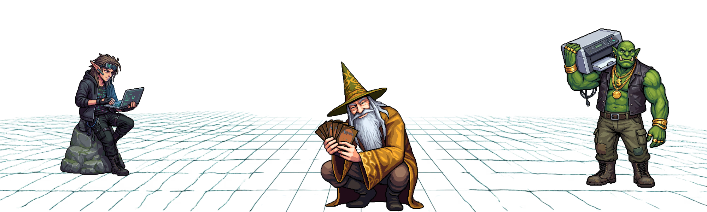

# DeckGen

A web-based GUI toolkit for building custom proxy cards, assembling print-ready card sheets, and converting card images to standard-size PDFs.

---

## Requirements

- **Python 3.10+**
- **Poppler (`pdftoppm`)** installed and available on your `PATH` (used for rendering PDF pages to PNG previews and print sheets)
  - Linux (Debian/Ubuntu): `sudo apt install poppler-utils`
  - macOS (Homebrew): `brew install poppler`
  - Windows: install Poppler for Windows and add its `bin/` folder to `PATH`
- **Assets folder (Required)**:
  Download the `assets` package from [Google Drive](https://drive.google.com/file/d/1C5r1OsjAq7FGWpso7icj8tdvipJ35DfH/view?usp=sharing) and extract it into the **root directory of the project** so that `assets/` sits alongside `requirements.txt` and `gui/`:
  ```text
  deckgen/
  ├── assets/
  ├── gui/
  ├── requirements.txt
  └── README.md
  ```

### Python Dependencies

Install the required Python packages with:

```bash
pip install -r requirements.txt
```

---

## Launching the GUI

Start the local web server from the project root:

```bash
python gui
```

Then open your browser at `http://localhost:8888`.

---

## Using the GUI

### Navigation Bar (Top)
- **Home / Card Builder / Deck Generator**: Switch between tools. Your current workspace state is preserved automatically in browser storage.
- **💾 Save Project**: Downloads a complete snapshot (`state_<date>.json`) containing both your Card Builder and Deck Generator settings, folder paths, and loaded cards.
- **📂 Load Project**: Restores a previously saved `state_<date>.json` file so you can resume right where you left off.
- **🌙 / ☀**: Toggle between light and dark themes.

---

### 1. Card Builder (`/card-builder`)
Design and customize individual cards before exporting them as standard-size PDFs:

1. **Deck Folder**: Click **📁 Browse** to select (or create) your working deck folder.
2. **Load Cards**:
   - **Scryfall Search**: Enter a card name and click **Search** to fetch card metadata, artwork, and auto-selected frame layers.
   - **Import MTGO List (`.txt`)**: Select an MTGO-format `.txt` decklist and click **Parse .txt & Save JSONs** (you can click **✕ Cancel** at any time to abort). Parsed cards are cached inside `<deck-folder>/json/` so subsequent loads are instant.
3. **Customize**:
   - **Frame Style & Layers**: Pick frame styles (e.g., `Automated Templates/normal`) and individual frame layer components.
   - **Artwork**: Paste an image URL or upload local artwork, adjust zoom/offset sliders, or click **✂️ Crop Art to Box** to interactively crop the image (drag to move, drag edges/corners to resize, or enable *Aspect Lock* to match the Art Box ratio).
   - **Text & Layout**: Edit card name, mana cost, type line, set code/rarity, oracle/flavor text, P/T, artist, contrast colors, and enable **Interactive Mode** to drag/resize elements directly on the canvas. Use **Undo / Redo** as needed.
4. **Save & Export**:
   - **Save JSON** saves the card configuration to `<deck-folder>/json/`.
   - **Export PDF** composites a high-resolution PDF into `<deck-folder>/fronts/`.

---

### 2. Deck Generator (`/deck-generator`)
Arrange your card PDFs into print-ready sheets with cut marks and card backs:

1. **Fronts Tab**:
   - Load card PDFs via **📁 Load PDF Folder** or set the **Export directory** in the **Export** tab.
   - Click **📋 Verify** to inspect your deck against an `.xml` or MTGO `.txt` list and duplicate any missing repeated cards.
   - Configure **Paper** (`a3`, `a4`, `a4-3`), **Landscape**, **Cut lines** (`none`, `full`, `corners`), **Card spacing (mm)**, **Cut color**, **Thickness**, and **Mark length**.
2. **Backs Tab**:
   - Optionally upload a generic **Card back** (PDF or image). If omitted, cards without a custom back render as blank white backs.
   - Click **🔄 Custom backs / MDFC (PDF)** to assign specific PDF backs to double-faced or selected cards.
3. **Live Paginated Preview**:
   - The main preview area automatically renders your sheets for both **Fronts** and **Backs** (mirroring backs for duplex printing by default).
   - Use **◀ / ▶** at the top of the preview to browse across all pages, and any updates to card PDFs in your deck folder will refresh automatically.
4. **Export Tab**:
   - Click **📁 Browse** to choose or create the destination folder.
   - Select **Face** (`fronts` or `backs`) and click **Generate PDF** to build the final multi-page print sheet PDF.

---

### 3. Image Converter (`/image-converter`)
Quickly convert `.png` or `.jpg` card images into standard-sized PDF files ready for Deck Generator.

---

## Support

If you find DeckGen useful, you can support the project here:

[](https://buymeacoffee.com/cridonoso)
