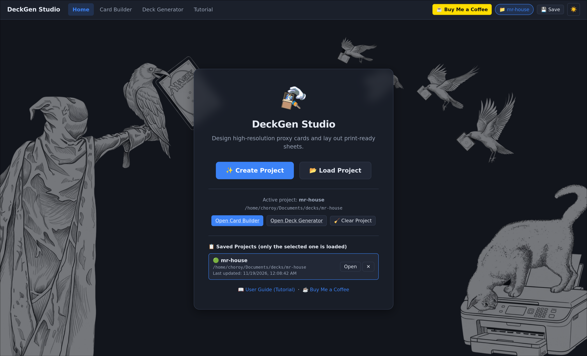
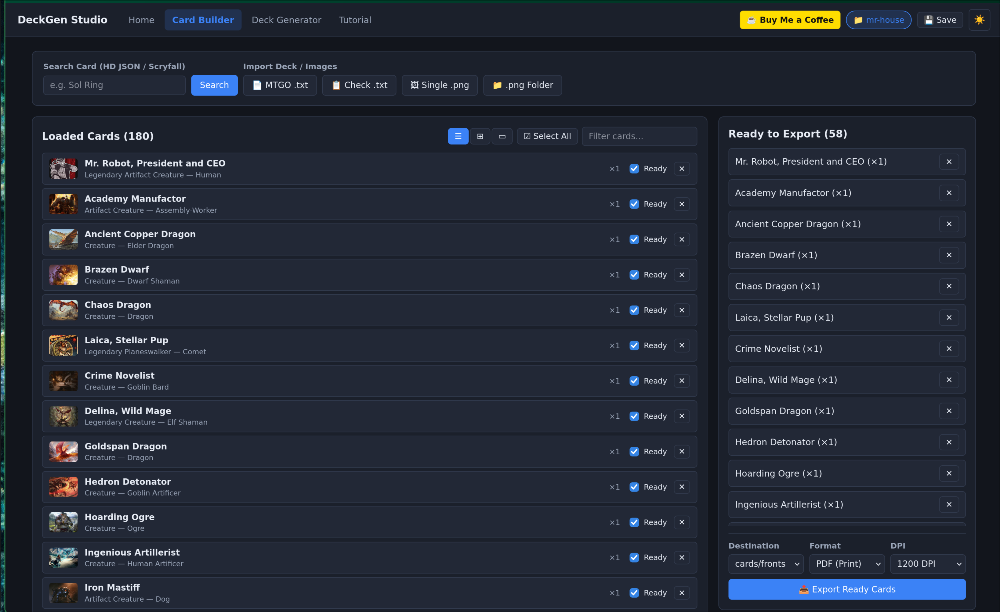

# DeckGen Studio

Hybrid local web application (**Python FastAPI** backend + **HTML/CSS/Vanilla ES Modules** frontend, zero build step) for designing high-resolution Magic: The Gathering proxy cards and laying out print-ready PDF sheets.

## Visual Preview



| Card Builder | Deck Generator |
| :---: | :---: |
|  |  |

## Quick Start

DeckGen Studio needs **Python 3.10 or newer** (it is developed on **Python 3.14.9**). The Python that ships with macOS (3.9) is too old and fails at startup with `TypeError: unsupported operand type(s) for |`.

### 1. Create a Python 3.14.9 virtual environment

The easiest way on both platforms is [uv](https://docs.astral.sh/uv/), which downloads the exact Python version for you.

**macOS** (Terminal):

```bash
brew install uv                      # or: curl -LsSf https://astral.sh/uv/install.sh | sh
uv python install 3.14.9

cd path/to/deckgen
uv venv --seed --python 3.14.9 .venv  # --seed installs pip inside the venv
source .venv/bin/activate
python --version                     # Python 3.14.9
```

**Windows** (PowerShell):

```powershell
winget install --id=astral-sh.uv -e  # or: powershell -ExecutionPolicy ByPass -c "irm https://astral.sh/uv/install.ps1 | iex"
uv python install 3.14.9

cd path\to\deckgen
uv venv --seed --python 3.14.9 .venv  # --seed installs pip inside the venv
.venv\Scripts\Activate.ps1           # cmd.exe: .venv\Scripts\activate.bat
python --version                     # Python 3.14.9
```

If PowerShell blocks the activation script, run `Set-ExecutionPolicy -Scope CurrentUser RemoteSigned` once and try again.

#### Without uv (official installer from python.org)

Install Python 3.14.9 from [python.org/downloads](https://www.python.org/downloads/). On Windows, tick **"Add python.exe to PATH"** in the installer. Then:

```bash
# macOS
python3.14 -m venv .venv
source .venv/bin/activate
```

```powershell
# Windows
py -3.14 -m venv .venv
.venv\Scripts\Activate.ps1
```

If you already have an old `.venv` (for example, one created with Python 3.9), delete it first: `rm -rf .venv` on macOS or `Remove-Item -Recurse -Force .venv` on Windows.

### 2. Install dependencies and run

With the virtual environment activated:

```bash
pip install -r requirements.txt      # or: uv pip install -r requirements.txt
python run.py
```

Launcher options (`run.py`):
- `--port 8766` (automatically picks the next free port if busy)
- `--host 127.0.0.1`
- `--no-browser` (starts the server without opening a browser tab)

### Assets (frames, fonts, mana & set symbols)
- Download [Templates](https://drive.google.com/drive/folders/1TsvefQ6QlSJNmvgfCxoEI61KzS1reWYn?usp=sharing) (updated: 22-11-2026) and extract it into the root folder of this project. 

Your directory tree should look like:

```text
.
├── assets
│   ├── resources
│   │   ├── frames              # frame layers (PNG/JPG/SVG), one folder per frame family
│   │   │   ├── m15
│   │   │   ├── 8th
│   │   │   ├── adventure
│   │   │   └── ...
│   │   ├── _shared
│   │   │   ├── fonts           # Beleren, MPlantin, Matrix, ...
│   │   │   ├── mana_symbols    # one SVG per symbol code ({W}, {2}, {+1}, ...)
│   │   │   └── set_symbols     # one SVG per set/rarity (e.g. 10e-c.svg)
│   │   └── manifest.json
│   ├── scryfall-map.json       # rules that map Scryfall card data to frame taxonomy
│   ├── taxonomy.json
│   └── fixtures                # sample Scryfall cards used by the test scripts
├── gui
│   ├── app.py
│   ├── config.py
│   ├── core
│   ├── data                    # art JSONs, frame_catalog/layouts/metadata, cache/
│   ├── __init__.py
│   ├── __main__.py
│   ├── routes
│   ├── services
│   ├── static
│   ├── templates
│   └── utils
├── scripts
├── README.md
├── requirements.txt
└── run.py
```

If `assets/resources` is missing, the app still starts but logs a warning, `/assets` is not mounted and the frame catalog is empty.

### Frames

Frames are no longer picked from fixed template styles. When a card is imported from Scryfall, the **frame resolver** (`gui/core/frame_resolver.py`) reads its data (layout, colors, type line, frame era, frame effects, border, ...), infers a taxonomy using `assets/scryfall-map.json`, and selects the matching layers from `assets/resources/frames/`. Double-faced cards (transform, modal DFC, reversible) get one recipe per face.

- Frame files are discovered directly from disk. Optional per-file metadata comes from `gui/data/frame_metadata.json`; files without metadata get a role (`base_frame`, `crown`, `pt_box`, `stamp`, `border`, ...) inferred from their path.
- The Frame Components picker is ordered by `gui/data/frame_catalog.json`. Any new file you drop into `assets/resources/frames/<folder>/` appears automatically under **Local Folders (Added)**.
- Text and art positions per template live in `gui/data/frame_layouts.json` (defaults in `gui/core/card_layouts.py`).
- Each imported card is stored as a card project (`gui/data/cache/projects/<id>.json`) and referenced from the workspace `state.json`.
- Cards are exported server-side as **1500×2100 PNG** (`gui/core/recipe_renderer.py`). SVG symbols are rasterized with the first available of `cairosvg`, `rsvg-convert`, `inkscape` or ImageMagick `convert`.

Projects saved with the older `Templates/<style>` layout are **not** migrated; re-import those cards.

## Key Features

- **Landing & Workspace Root**:
  - `Create Project` / `Load Project` linked to a Root Directory with `state.json` persistence.
  - **Saved Projects** list tracking last-updated timestamps (only the active project is loaded into memory) + `Clear Project`.
- **Card Builder**:
  - Import MTGO `.txt` decklists (with live progress bar), single `.png` files, `.png` folders, or search by name (`gui/data/unified_art.json` + extra `gui/data/*.json` via inverted-token & fuzzy search, with rate-limited Scryfall fallback and `/api/art/proxy`).
  - `Loaded Cards` vs. `Ready to Export` workflow with `Select All`, per-card single-export collision check, and batch export progress bar.
  - Interactive preview (click/drag/resize/wheel), **Undo / Redo** (`Ctrl+Z` / `Ctrl+Y`), independent per-element text colors, automatic parenthesized **Original Name**, **Art Over Title / Frame (Pop-Out)**, duplicable translucent **Background Boxes**, **Template Crop Masks**, independent **Layer Manager** with drag & drop indicator, and **Frame Components** hover previews.
- **Deck Generator**:
  - Unified Office Ribbon toolbar with **Fronts Folder**, **Set Back (PDF/PNG)** (auto-converts PNG/JPG to PDF), paper/cut-mark settings, **Dual Preview** (`Both`, `Only Fronts`, `Only Backs`), and individual card scaling.
  - Click any **Front** card to open the **Custom Back** modal (shows project card thumbnails + upload from computer for flip/DFC cards) and update **Backs** immediately.
- **Tutorial**: Built-in interactive User Guide tab covering the full workflow.

## Project Structure

- `run.py`: Cross-platform standalone launcher (Linux, macOS, Windows).
- `gui/app.py`: FastAPI server, static/assets mounting, and no-cache headers.
- `gui/core/workspace.py`: Root Directory management, atomic `state.json` persistence, and collision versioning (`-1`, `-2`).
- `gui/core/art_index.py`: $O(1)$ + inverted-token + fuzzy index over `gui/data/unified_art.json` and extra JSONs, plus Scryfall cache.
- `gui/core/asset_catalog.py`: Folder-based discovery of frames, fonts, mana and set symbols.
- `gui/core/frame_resolver.py`: Scryfall card → frame recipe (taxonomy inference and layer selection).
- `gui/core/recipe_renderer.py` (re-exported by `card_renderer.py`): Draws a recipe (frames, art, text, mana and set symbols) to PNG.
- `gui/core/svg_raster.py`: SVG → PNG rasterization with a cache in `~/.cache/deckgen/svg_cache`.
- `gui/core/card_layouts.py`: Default card layout and per-template layouts from `gui/data/frame_layouts.json`.
- `gui/core/asset_paths.py`: Asset filesystem paths and `/assets/...` URLs.
- `gui/services/card_project.py`: Scryfall card resolution and card project storage.
- `gui/core/sheets.py` & `gui/services/deck_service.py`: Sheet layout, individual card scaling, custom backs, and background PNG/JPG → PDF conversion.
- `gui/static/js/modules/`: Modular ES6 frontend (`workspace_client.js`, `crop_masks.js`, `layer_manager.js`).
- `scripts/`: Verification scripts (`frame_resolver_smoke.py`, `render_recipe_cli.py`, `test_e2e_archetypes.py`, `validate_assets_integrity.py`, `verify_browser_e2e.py`) and the art scrapers that produced the art JSONs.

## External Tools & Credits

- [Art of MtG](http://www.artofmtg.com/) — High-resolution Magic: The Gathering artwork archive.
- [Scryfall API](https://scryfall.com/docs/api) — Card metadata, printings, and fallback artwork lookup.

## Support

If you find this project useful, you can support its development here: [Buy Me a Coffee](https://buymeacoffee.com/cridonoso)

## License

This project is free and open-source software licensed under the **MIT License**.
