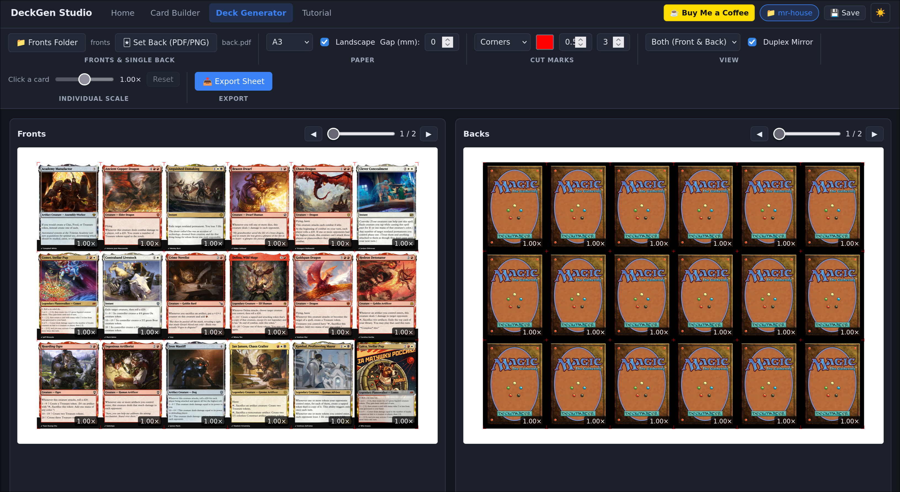

# DeckGen Studio

Hybrid local web application (**Python FastAPI** backend + **HTML/CSS/Vanilla ES Modules** frontend, zero build step) for designing high-resolution Magic: The Gathering proxy cards and laying out print-ready PDF sheets.

## Visual Preview


| Card Builder | Deck Generator |
| :---: | :---: |
|  |  |

## Quick Start

```bash
pip install -r requirements.txt
python run.py
```

Launcher options (`run.py`):
- `--port 8766` (automatically picks the next free port if busy)
- `--host 127.0.0.1`
- `--no-browser` (starts the server without opening a browser tab)

### Assets & Custom Landing Background (`mana-master`, `keyrune-master`, `Automated Templates`, `Manual Templates`, and HQ Arts) 
- Download [Templates](https://drive.google.com/file/d/1BhOkhvsduhb0yyGTecgy4alU49KAr84B/view?usp=drive_link) (updated: 20-11-2026) and extract it into the root folder of this project. 

Your directory tree should look like:

```text
.
├── assets
│   ├── artofmtg_artists_cards.json
│   ├── artofmtg_cards.json
│   ├── Automated Templates
│   ├── bloomburrow.json
│   ├── foundations.json
│   ├── keyrune-master
│   ├── lost-caverns.json
│   ├── mana-master
│   ├── Manual Templates
│   ├── murders-karlov.json
│   └── wild-eldraine.json
├── gui
│   ├── app.py
│   ├── config.py
│   ├── core
│   ├── data
│   ├── __init__.py
│   ├── __main__.py
│   ├── routes
│   ├── services
│   ├── static
│   ├── templates
│   └── utils
├── tests
├── README.md
├── requirements.txt
└── run.py
```

## Key Features

- **Landing & Workspace Root**:
  - `Create Project` / `Load Project` linked to a Root Directory with `state.json` persistence.
  - **Saved Projects** list tracking last-updated timestamps (only the active project is loaded into memory) + `Clear Project`.
- **Card Builder**:
  - Import MTGO `.txt` decklists (with live progress bar), single `.png` files, `.png` folders, or search by name (`gui/data/unified_art.json` + extra `gui/data/*.json` via inverted-token & fuzzy search, with rate-limited Scryfall fallback and `/api/art/proxy`).
  - `Loaded Cards` vs. `Ready to Export` workflow with `Select All`, per-card single-export collision check, and batch export progress bar.
  - Interactive preview (click/drag/resize/wheel), **Undo / Redo** (`Ctrl+Z` / `Ctrl+Y`), independent per-element text colors, automatic parenthesized **Original Name**, **Art Over Title / Frame (Pop-Out)**, duplicable translucent **Background Boxes**, **Template Crop Masks**, independent **Layer Manager** with drag & drop indicator, and **Frame Components** hover previews.
- **Deck Generator**:
  - Unified Office Ribbon toolbar with **Fronts Folder**, **Set Back (PDF/PNG)** (auto-converts PNG/JPG to PDF), paper/cut-mark settings, **Dual Preview** (`Both`, `Only Fronts`, `Only Backs`), and individual card scaling.
  - Click any **Front** card to open the **Custom Back** modal (shows project card thumbnails + upload from computer for flip/DFC cards) and update **Backs** immediately.
- **Tutorial**: Built-in interactive User Guide tab covering the full workflow.

## Project Structure

- `run.py`: Cross-platform standalone launcher (Linux, macOS, Windows).
- `gui/app.py`: FastAPI server, static/assets mounting, and no-cache headers.
- `gui/core/workspace.py`: Root Directory management, atomic `state.json` persistence, and collision versioning (`-1`, `-2`).
- `gui/core/art_index.py`: $O(1)$ + inverted-token + fuzzy index over `gui/data/unified_art.json` and extra JSONs, plus Scryfall cache.
- `gui/core/card_renderer.py`: Independent layer composition, pop-out art, brightness, background color, and PDF/PNG export.
- `gui/core/sheets.py` & `gui/services/deck_service.py`: Sheet layout, individual card scaling, custom backs, and background PNG/JPG → PDF conversion.
- `gui/static/js/modules/`: Modular ES6 frontend (`workspace_client.js`, `crop_masks.js`, `layer_manager.js`).

## Tests

```bash
python3 -m unittest discover -s tests -v
```

## External Tools & Credits

- [Art of MtG](http://www.artofmtg.com/) — High-resolution Magic: The Gathering artwork archive.
- [Scryfall API](https://scryfall.com/docs/api) — Card metadata, printings, and fallback artwork lookup.

## Support

If you find this project useful, you can support its development here: [Buy Me a Coffee](https://buymeacoffee.com/cridonoso)

## License

This project is free and open-source software licensed under the **MIT License**.
